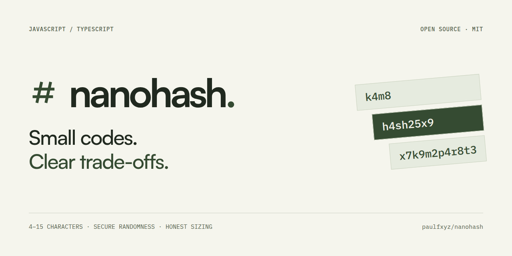
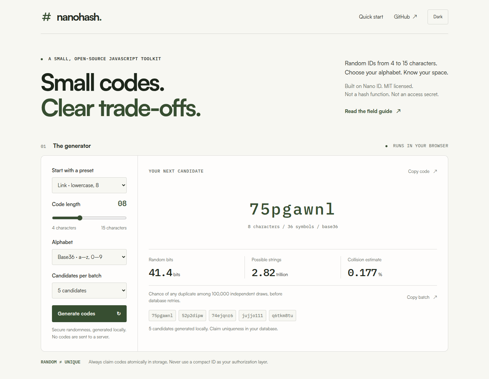
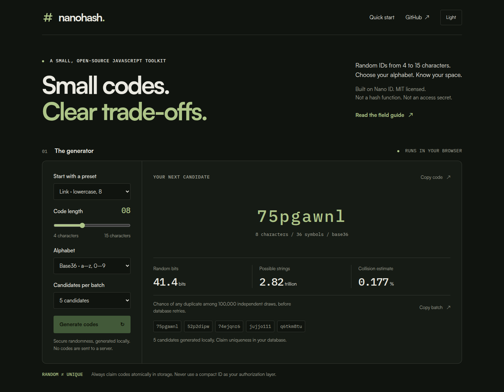
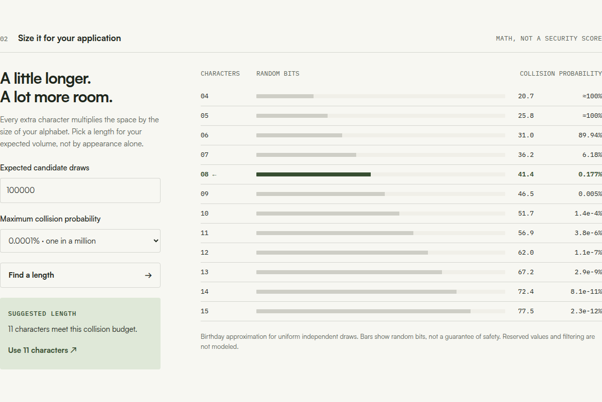
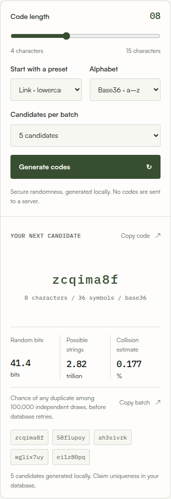

# nanohash



Compact random IDs, sized honestly. A small JavaScript library for configurable 4–15 character codes, explicit collision estimates, and database-backed allocation.

[](https://github.com/paulfxyz/nanohash/actions/workflows/ci.yml)
[MIT license](LICENSE) · ESM + CommonJS · TypeScript declarations · Node 22+ · Browser playground

Despite the name, nanohash generates random identifiers, not cryptographic hashes. It builds on [Nano ID's secure generator](https://github.com/ai/nanoid), and it never treats a compact code as an access-control mechanism.

## Start in a minute

The GitHub release is installable directly; this project is not yet published to npm. Do not run `npm install nanohash`: the [unscoped npm name](https://www.npmjs.com/package/nanohash) belongs to an unrelated package.

```sh
npm install github:paulfxyz/nanohash#v0.1.0
```

```js
import { nanohash, createGenerator } from "@paulfxyz/nanohash";

nanohash(); // a fresh 8-character lowercase candidate

const next = createGenerator({ alphabet: "base36", length: 10 });
next();
next.batch(5);
```

```js
// CommonJS works too.
const { nanohash } = require("@paulfxyz/nanohash");
console.log(nanohash());
```

Use the same package through a browser bundler, or import the committed `dist/index.js` from your own static hosting. Generation requires secure Web Crypto and fails explicitly when it is unavailable.

## The useful layer around a random ID

- **Practical alphabets:** Lowercase Base36, mixed-case Base62, URL64, Human32, and validated custom characters.
- **Length, deliberately chosen:** Every integer from 4 to 15; lengths 4–5 require an explicit acknowledgement.
- **Honest analysis:** Exact character-space size, random bits, collision estimates, and separate any-code guessing estimates.
- **Atomic allocation:** A storage-agnostic helper retries actual conflicts, not database errors.
- **Small operational surface:** ESM, CJS, declarations, a CLI, and separate analysis/allocation entry points.

The published build has no runtime npm dependencies because it bundles the relevant Nano ID implementation. That does not mean “no third-party code”; attribution is retained in [third-party notices](THIRD_PARTY_NOTICES.md).

## Try the playground

Generate real codes, compare all twelve supported lengths, and find the shortest length meeting a collision budget. The playground has light and dark modes and performs generation and sizing locally in the browser.



```sh
git clone https://github.com/paulfxyz/nanohash.git
cd nanohash
npm ci
npm run site:build
npm run site:serve
# Open http://127.0.0.1:4173
```

<details>
<summary>Dark mode, sizing workbench, and mobile screenshots</summary>







</details>

## Presets and alphabets

Presets are conveniences, not security levels. Override a preset's length, or choose an alphabet and length explicitly.

| Preset | Alphabet | Length | Intended use |
|---|---|---:|---|
| `link` | Base36 | 8 | Lowercase public URL identifiers |
| `tiny` | Base36 | 5 | Small public namespaces, explicit opt-in |
| `dense` | URL64 | 8 | More information per character |
| `long` | Base36 | 12 | More room with lowercase readability |
| `human` | Human32 | 8 | Remove the letters `i`, `l`, `o`, and `u` |

```js
const dense = createGenerator({ preset: "dense", length: 12 });
const publicCampaign = createGenerator({ preset: "tiny", allowTiny: true });
const custom = createGenerator({ characters: "abcdefgh23456789", length: 10 });
```

Human32 is an alphabet choice, not a decoder: it does not automatically convert `O` to `0` or normalize user input. Generated code comparisons remain exact.

## Choose a length with a model

Use expected candidate draws for collision analysis, not a claim that the package has observed your database. Probabilities are floating-point estimates for independent uniform draws; exact namespace size is returned as a decimal string.

```js
import { analyzeSpace, recommendLength } from "@paulfxyz/nanohash/analysis";

const info = analyzeSpace({
  alphabet: "base36",
  length: 8,
  generatedCount: 100_000,
  activeCodes: 10_000,
  guesses: 1_000_000
});

info.space;                 // "2821109907456"
info.entropyBits;           // about 41.36
info.collisionProbability;  // about 0.00177076, not a percentage
info.anyHitProbability;     // chance of finding ANY of the active codes

const choice = recommendLength({
  alphabet: "base36",
  generatedCount: 100_000,
  maxCollisionProbability: 0.000001
});
choice.length; // 11
```

The eight-character default optimizes convenience for public identifiers with database uniqueness checks. It is not a promise of meeting every probability budget; the stricter example above appropriately recommends eleven.


## Claim uniqueness where the data lives

Random generation returns candidates. A database constraint, atomic insertion, and narrowly handled conflicts establish uniqueness within your application's namespace.

```js
import { createGenerator } from "@paulfxyz/nanohash";
import { claimUnique } from "@paulfxyz/nanohash/allocation";

const result = await claimUnique({
  generate: createGenerator(),
  isReserved: code => reservedRoutes.has(code),
  maxAttempts: 5,
  claim: async code => {
    // Your adapter MUST atomically insert under a unique constraint.
    // Return conflict only for a confirmed collision on the code.
    return await storage.tryInsertCode(code);
    // { status: "claimed", value: record }
    // or { status: "conflict" }
  }
});
```

`storage` and `reservedRoutes` above are application-owned interfaces, not hidden package services. See the [runnable in-memory example](examples/allocation.mjs) and [PostgreSQL integration recipe](docs/integrations.md) for concrete implementations and limitations.

## CLI

Install the release in your project and invoke the local binary. Analysis and recommendation commands emit JSON, with probability values expressed from 0 to 1.

```sh
npx nanohash --length 8 --count 5
npx nanohash --length 5 --tiny
npx nanohash analyze --length 8 --generated 100000 --json
npx nanohash recommend --generated 100000 --risk 0.000001
```

Run these commands only after installing this scoped package, so `npx` uses its local binary rather than fetching the unrelated unscoped package. Use `./node_modules/.bin/nanohash` if the distinction is important in a script.

## Security boundaries

- **Random is not unique:** Always enforce a unique constraint for allocated codes.
- **Unpredictable is not authorization:** Compact codes are for public identifiers, not passwords, sessions, recovery tokens, or private-file access.
- **Shorter means less space:** Four- and five-character codes are deliberately gated; even fifteen URL64 characters provide only 90 random bits.
- **No silent downgrade:** There is no `Math.random` fallback or user-supplied RNG hook.
- **No hidden service:** This package does not store mappings, fetch destinations, redirect visitors, or provide authentication.
- **No new cryptography:** Generation uses Nano ID; SHA/HMAC and reversible numeric encodings are not part of this release.

The project has automated tests, not an independent security audit. Read the [security model](docs/security.md) and [probability assumptions](docs/sizing.md) before using it.

## Documentation and development

| Document | Covers |
|---|---|
| [API reference](docs/api.md) | Every export, option, return value, and error boundary |
| [Sizing guide](docs/sizing.md) | Entropy, birthday approximations, guessing, and namespace occupancy |
| [Integration guide](docs/integrations.md) | Storage allocation and React/API/MCP short-link architecture |
| [Security model](docs/security.md) | Scope, abuse boundaries, and safe operational defaults |
| [Compatibility](docs/compatibility.md) | ESM/CJS, browsers, workers, TypeScript, and packaging |
| [Release guide](docs/releasing.md) | Checks, GitHub releases, and the separate npm publication step |
| [QA inventory](docs/qa.md) | Functional and visual checks used for this release |
| [Contributing](CONTRIBUTING.md) | Development, tests, and project scope |

```sh
npm ci
npm run check          # build, unit/CLI tests, and ESM/CJS type checks
npm run pack:check     # clean tarball install: import, require, and CLI
npx playwright install chromium
npm run test:e2e       # desktop and mobile Chromium
npm run site:build
npm run site:serve     # leave running, then run npm run assets separately
```

Built distributions are committed so a tagged GitHub install needs no install-time build scripts. Rebuild and commit `dist/` whenever the source changes.

## Why the name?

The name reflects short, hash-like codes used in links, not a cryptographic digest API. The project is independent of the existing unscoped npm package and preserves the upstream Nano ID attribution.

Created by Paul Fleury and released under the [MIT license](LICENSE). Contributions that improve practical safety, clarity, and compatibility are welcome.
