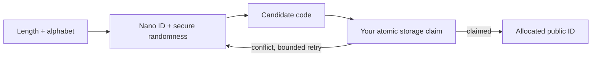

# nanohash

<p align="center">
  <picture>
    <source media="(prefers-color-scheme: dark)" srcset="assets/logo-dark.svg">
    
  </picture>
</p>

<p align="center">
  <strong>Small codes. Clear trade-offs.</strong><br>
  Compact, URL-safe random IDs for JavaScript and TypeScript.<br>
  Choose your alphabet, understand your space, and claim uniqueness where your data lives.
</p>

<p align="center">
  <a href="https://github.com/paulfxyz/nanohash/releases"></a>
  <a href="https://github.com/paulfxyz/nanohash/actions/workflows/ci.yml"></a>
  <a href="LICENSE"></a>
  <a href="docs/compatibility.md"></a>
  <a href="docs/compatibility.md"></a>
  <a href="types/index.d.ts"></a>
</p>

<!-- nanohash:size-badges:start -->
<p align="center">
  <a href="docs/bundle-size.md"></a>
  <a href="docs/bundle-size.md"></a>
  <a href="docs/bundle-size.md"></a>
  <a href="THIRD_PARTY_NOTICES.md"></a>
  <a href="#presets-and-alphabets"></a>
</p>
<!-- nanohash:size-badges:end -->

<p align="center">
  <a href="#install">Quick start</a> ·
  <a href="#lite-entry-point">Lite</a> ·
  <a href="#bundle-size">Measured size</a> ·
  <a href="#playground-and-screenshots">Playground</a> ·
  <a href="docs/api.md">API reference</a> ·
  <a href="docs/security.md">Security model</a> ·
  <a href="CONTRIBUTING.md">Contribute</a>
</p>

---

## What is nanohash?

nanohash is a small toolkit for the decisions around a short random identifier: how long it should be, which alphabet it uses, how often candidate collisions might occur, and how to reserve it safely in storage. It combines [Nano ID's secure generation](https://github.com/ai/nanoid) with presets, explicit input validation, sizing helpers, and an optional atomic-allocation loop.

Despite the name, it is **not a cryptographic hash function**. It creates random public identifiers, not SHA digests, encryption keys, password-reset tokens, or a stateless encoding of arbitrary URLs.

| At a glance | What ships |
|---|---|
| Code length | Every integer from 4 to 15; 4–5 require explicit opt-in |
| Alphabets | Base36, Base62, URL64, Human32, or distinct custom URL-safe characters |
| Defaults | 8 lowercase alphanumeric characters |
| Randomness | Nano ID-backed secure generation; no `Math.random` fallback |
| Distribution | Full and `/lite` ESM/CJS entries, TypeScript declarations, and a CLI |
| Sizing | Exact character-space counts and clearly labelled probability estimates |
| Allocation | Storage-agnostic claims, reserved-code checks, and bounded conflict retries |
| Runtime dependencies | No runtime npm dependencies; Nano ID code is bundled and attributed |
| License and release | MIT; installable GitHub release, not yet published to npm |

## Why this exists

An ID generator can give you a string, but it cannot decide whether six characters are enough for your application or whether your database has already allocated that string. nanohash puts those decisions next to the generator, without becoming a database, hosted shortener, or authentication framework.

- **Choose deliberately:** See the difference between a shorter URL and a smaller namespace.
- **Stay consistent:** Use the same presets and validation in scripts, admin tools, and application services.
- **Allocate correctly:** Retry genuine code conflicts while surfacing real storage failures.
- **Keep the boundary visible:** A public identifier is not an access secret, and random does not mean unique.

If you only want the smallest possible random-ID primitive, use Nano ID directly. Choose nanohash when its policy, sizing, and allocation helpers save you application code and make the trade-offs clearer.

## Install

The package identity is `@paulfxyz/nanohash`, and the current release is installed from GitHub. The [unscoped npm package `nanohash`](https://www.npmjs.com/package/nanohash) is an unrelated project; do not install it expecting this library.

```sh
npm install github:paulfxyz/nanohash#v0.2.0
```

### JavaScript and TypeScript

Start with the default, then configure only what you need. The same API includes TypeScript declarations without requiring TypeScript at runtime.

```js
import { nanohash, createGenerator } from "@paulfxyz/nanohash";

nanohash(); // fresh 8-character lowercase candidate

const next = createGenerator({
  alphabet: "base36",
  length: 10
});

const candidate = next();
const batch = next.batch(5);
```

### CommonJS and browsers

CommonJS has its own built entry point and declarations. Browser bundlers can use the ESM entry; alternatively, serve `dist/index.js` from your own static hosting.

```js
const { nanohash } = require("@paulfxyz/nanohash");
console.log(nanohash());
```

Generation requires secure Web Crypto and fails explicitly when it is unavailable. Read the [compatibility matrix](docs/compatibility.md) before adopting an untested browser, worker provider, or mobile runtime.

## Lite entry point

Only need a lowercase public ID? Import `@paulfxyz/nanohash/lite` to get a standalone generator without the full toolkit's presets, batch API, sizing functions, or allocation helpers.

```js
import { nanohash } from "@paulfxyz/nanohash/lite";

nanohash();                          // 8 lowercase Base36 characters
nanohash(12);                        // 12 characters
nanohash(5, { allowTiny: true });     // explicit tiny public-code opt-in
```

```js
const { nanohash } = require("@paulfxyz/nanohash/lite");
console.log(nanohash(10));
```

Lite retains secure Nano ID randomness, integer length validation, strict option checks, and fail-closed Web Crypto handling. Its fixed alphabet is `0123456789abcdefghijklmnopqrstuvwxyz`; the only option is `{ allowTiny?: boolean }`.

| Choose lite when | Choose the full toolkit when |
|---|---|
| You want one Base36 candidate per call | You need presets, custom alphabets, or batching |
| You only need the length and tiny-code acknowledgement | You need format validation, sizing, or recommendations |
| A separately measured small browser import matters | You want the additional application helpers |

The two-argument signature above belongs to `/lite`, not the root `nanohash(length)` shorthand. The existing root API is unchanged; read the [lite reference](docs/lite.md) for its limits, error behavior, and standalone-browser example.

## Bundle size

<!-- nanohash:size-summary:start -->
The separate lite generator is **579 bytes minified + gzip**; the full generator factory is **1,369 bytes**, and the full toolkit's root browser API is **2,707 bytes**, under the same minified + gzip settings. These measurements include the bundled Nano ID implementation, not just a wrapper.
<!-- nanohash:size-summary:end -->

<!-- nanohash:size-table:start -->
| Import surface | Minified JS | Minified + gzip | Minified + Brotli |
|---|---:|---:|---:|
| Lite generator | 949 B | 579 B | 509 B |
| Generator factory | 3,171 B | 1,369 B | 1,216 B |
| nanohash() shorthand | 3,213 B | 1,385 B | 1,235 B |
| Analysis entry point | 3,681 B | 1,532 B | 1,331 B |
| Allocation entry point | 2,092 B | 969 B | 841 B |
| Full toolkit (root API) | 6,821 B | 2,707 B | 2,384 B |
<!-- nanohash:size-table:end -->

These are browser ESM bundle measurements using esbuild, tree-shaking, and the compression settings documented in the [reproducible size report](docs/bundle-size.md). They are not the size of the repository, npm archive, installed package, CLI, screenshots, or documentation.

We do not claim a 130-byte toolkit: the [Nano ID CJS README's 130-byte figure](https://github.com/zlocate/nanoid-cjs) is a minified-and-gzipped generator claim, while nanohash intentionally supplies more functionality. Lite is measured separately, and CI checks both the published figures and its 750-byte minified-plus-gzip ceiling.

## Presets and alphabets

Presets are conveniences, not security levels. Override a preset's length, or choose an alphabet and length explicitly.

| Preset | Alphabet | Length | Good starting point for |
|---|---|---:|---|
| `link` | Base36 | 8 | Lowercase public URL identifiers |
| `tiny` | Base36 | 5 | Small public namespaces, explicit acknowledgement |
| `dense` | URL64 | 8 | More information per character when case and punctuation are acceptable |
| `long` | Base36 | 12 | Larger public namespaces with lowercase readability |
| `human` | Human32 | 8 | Removing the letters `i`, `l`, `o`, and `u` |

```js
const dense = createGenerator({ preset: "dense", length: 12 });
const publicCampaign = createGenerator({ preset: "tiny", allowTiny: true });
const custom = createGenerator({
  characters: "abcdefgh23456789",
  length: 10
});
```

Human32 is an alphabet choice, not a decoder: it does not normalize `O` to `0` or repair user input. Comparisons are exact, and lowercasing mixed-case output changes its distribution.

## Choose a length with a model

Use expected candidate draws for collision analysis, not a claim that the package has observed your database. The model assumes independent uniform draws and returns exact namespace size as a decimal string, with probabilities expressed from 0 to 1.

```js
import { analyzeSpace, recommendLength } from "@paulfxyz/nanohash/analysis";

const info = analyzeSpace({
  alphabet: "base36",
  length: 8,
  generatedCount: 100_000,
  activeCodes: 10_000,
  guesses: 1_000_000
});

info.space;                 // "2821109907456"
info.entropyBits;           // about 41.36
info.collisionProbability;  // about 0.00177076, before uniqueness retries
info.anyHitProbability;     // probability of finding ANY active code

const choice = recommendLength({
  alphabet: "base36",
  generatedCount: 100_000,
  maxCollisionProbability: 0.000001
});

choice.length; // 11
```

The eight-character default favors convenience for public identifiers with database uniqueness checks. It is not a promise of meeting every probability budget; the stricter example above appropriately recommends eleven.

If no length within the requested bounds meets the budget, the result explicitly says `feasible: false`. See the [sizing guide](docs/sizing.md) for the birthday approximation, guessing assumptions, filtering limitations, and the difference between active codes and lifetime allocations.

## Claim uniqueness where the data lives

A generated candidate becomes an allocated identifier only after your storage adapter atomically claims it. A preflight existence check followed by a separate insert is not sufficient under concurrency.



```js
import { createGenerator } from "@paulfxyz/nanohash";
import { claimUnique } from "@paulfxyz/nanohash/allocation";

const result = await claimUnique({
  generate: createGenerator(),
  isReserved: code => reservedRoutes.has(code),
  maxAttempts: 5,
  claim: async code => {
    // Your adapter atomically inserts under a unique constraint.
    return await storage.tryInsertCode(code);
    // { status: "claimed", value: record }
    // or { status: "conflict" }
  }
});
```

`storage` and `reservedRoutes` are application-owned interfaces, not hidden package services. The [runnable allocation example](examples/allocation.mjs) and [PostgreSQL recipe](docs/integrations.md) show concrete implementations and their limits.

Database outages are not collisions and are not retried as such. Keep idempotency, authorization, auditing, and destination validation in your application service.

## Where it fits

| Use case | nanohash provides | Your application still owns |
|---|---|---|
| Branded public links | Candidate generation, route reservations through a callback, collision retries | Mapping storage, HTTP redirects, destination policy, admin authentication |
| Public resource references | Compact, format-valid identifiers | Record ownership, permissions, persistence, and lifecycle |
| Small campaign aliases | Explicit tiny-code mode or larger generated codes | Namespace capacity, expiry, abuse controls, and non-reuse rules |
| API/MCP publishing workflows | A common generation/allocation contract | Tool authorization, human approvals, request idempotency, and audit history |

This library does not compress an arbitrary URL into a reversible short string. A URL-shortening application still needs a stored mapping and a server-side resolver; the [integration guide](docs/integrations.md) covers the React, API, and MCP boundaries.

## CLI

After installing the scoped GitHub package, invoke its local binary. This avoids accidentally downloading the unrelated unscoped package through `npx`.

```sh
./node_modules/.bin/nanohash --length 8 --count 5
./node_modules/.bin/nanohash --length 5 --tiny
./node_modules/.bin/nanohash analyze --length 8 --generated 100000 --json
./node_modules/.bin/nanohash recommend --generated 100000 --risk 0.000001
```

Use `--help` for the full flag list, including custom characters and guessing inputs. Exit codes distinguish success, invalid input/runtime failure, and an infeasible recommendation.

## Playground and screenshots

The playground runs the actual library, not a mock generator. It includes presets, custom alphabets, batch generation, copy controls, a twelve-length comparison, a collision-budget calculator, and light/dark themes.

<picture>
  <source media="(prefers-color-scheme: dark)" srcset="assets/screenshots/playground-dark.png">
  
</picture>

Generation and analysis run locally in the browser; no generated codes are sent to a server. The demo references external font providers, as documented in the [third-party notices](THIRD_PARTY_NOTICES.md).

```sh
git clone https://github.com/paulfxyz/nanohash.git
cd nanohash
npm ci
npm run site:build
npm run site:serve
# Open http://127.0.0.1:4173
```

<details>
<summary>See the sizing workbench</summary>


</details>

<details>
<summary>See the mobile generator</summary>


</details>

## Security boundaries

- **Random is not unique:** Enforce a storage uniqueness constraint for allocated codes.
- **Unpredictable is not authorization:** Do not use compact IDs as passwords, sessions, recovery tokens, or private-file access controls.
- **Shorter means less space:** Four- and five-character generation requires explicit acknowledgement; fifteen URL64 characters still provide only 90 random bits.
- **No silent downgrade:** There is no `Math.random` fallback or public custom-RNG hook.
- **No hidden backend:** The package does not store mappings, fetch destinations, redirect visitors, or authenticate callers.
- **No new cryptography:** SHA/HMAC functions, reversible numeric encodings, and encryption are outside this release.

The project has automated tests, not an independent security audit. Read the [security model](docs/security.md), and use [private vulnerability reporting](SECURITY.md) rather than posting sensitive material in public issues.

## Documentation map

| Guide | What you will find |
|---|---|
| [API reference](docs/api.md) | Every export, option, return value, and error boundary |
| [Lite reference](docs/lite.md) | The standalone Base36 generator, size limit, and omitted features |
| [Bundle size](docs/bundle-size.md) | Reproducible byte counts, compression settings, and fair comparison boundaries |
| [Sizing guide](docs/sizing.md) | Random bits, birthday approximations, guessing, and namespace occupancy |
| [Integration guide](docs/integrations.md) | Atomic storage, short-link routing, React, API, and MCP |
| [Security model](docs/security.md) | Scope, failure behavior, and application responsibilities |
| [Compatibility](docs/compatibility.md) | ESM/CJS, browser/worker limits, TypeScript, and packaging |
| [QA inventory](docs/qa.md) | Library, packaging, interaction, and visual checks |
| [Release procedure](docs/releasing.md) | GitHub releases and the separately authorized npm step |
| [Contributing](CONTRIBUTING.md) | Development workflow and contribution boundaries |
| [Brand assets](assets/BRAND.md) | Original marks, palette, banner, and screenshot provenance |

<details>
<summary>Repository layout</summary>

```text
src/                 Plain JavaScript implementation
types/               ESM/CommonJS declaration sources
dist/                Committed, ready-to-use builds
test/                Unit, CLI, type, and browser checks
site/                Interactive playground and brand card
scripts/             Build, package, size, and screenshot tooling
docs/                API, integration, sizing, security, and release guides
assets/              Original logos, banner, and real screenshots
.github/             CI, dependency updates, and contribution templates
examples/            Runnable Node, CommonJS, and allocation examples
```

</details>

## Develop and verify

Use the committed lockfile and rebuild `dist/` after source changes. The package is intentionally installable from a GitHub tag without an install-time build script.

```sh
npm ci
npm run check          # build, unit/CLI tests, ESM/CJS declarations
npm run test:docs      # documentation and asset links
npm run pack:check     # clean tarball installation
npm run size:check     # reference byte counts and badge drift; use Node 22
npx playwright install chromium
npm run test:e2e       # desktop and mobile Chromium
```

To update the measured figures, run `npm run size` on Node 22 and commit the report, README blocks, and badges together. To refresh screenshots, run the playground locally and execute `npm run assets`.

CI covers Node 22, 24, and 26, package installation, declarations, and desktop/mobile Chromium. The [compatibility guide](docs/compatibility.md) distinguishes tested environments from intended but uncertified ones.

## Questions worth asking

<details>
<summary>Is this a new hash algorithm?</summary>

No. The name describes the appearance of compact codes, not a digest algorithm; secure generation comes from Nano ID, with nanohash adding application-oriented policy and tooling.

</details>

<details>
<summary>Can I call it a 130-byte library?</summary>

No, not for this toolkit. Use the measured import-specific figures above with “minified + gzip” attached, and do not exclude the bundled generator or compare a full toolkit with a minimal primitive without saying so.

</details>

<details>
<summary>How can it have zero runtime npm dependencies if it uses Nano ID?</summary>

The relevant Nano ID implementation is bundled into the distribution. This removes a runtime package-install dependency, not the third-party code or its license obligations.

</details>

<details>
<summary>Is an eight-character code safe for a private document?</summary>

The document still needs authorization. Code length and low collision risk do not turn a public identifier into an access-control system.

</details>

## Roadmap and contribution

The separate lite entry point ships in v0.2.0, with its own tests, declarations, and size check. Useful next steps include additional independently verified runtimes, a second real-world storage adapter, and improvements supported by actual consumer feedback.

Open a [bug report](https://github.com/paulfxyz/nanohash/issues/new/choose) or follow the [contribution guide](CONTRIBUTING.md). Changes that improve clarity, compatibility, measurement accuracy, or application safety are especially welcome.

## License and credits

Created by Paul Fleury and released under the [MIT license](LICENSE). Nano ID's upstream copyright and permission notices are preserved in [THIRD_PARTY_NOTICES.md](THIRD_PARTY_NOTICES.md).

The project is independent of the existing unscoped npm package named `nanohash`. Original project graphics are included in this repository, while upstream trademarks and third-party font licenses remain their owners' responsibility.

<details>
<summary>Original project banner</summary>


</details>
